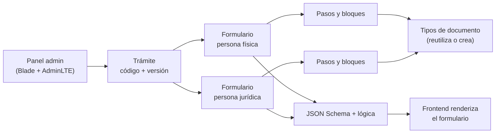
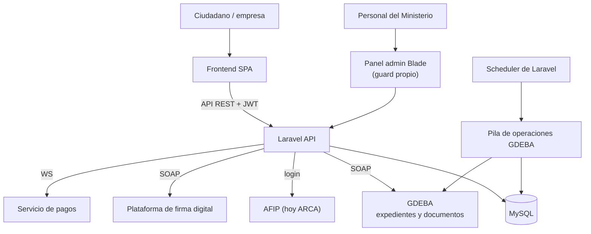
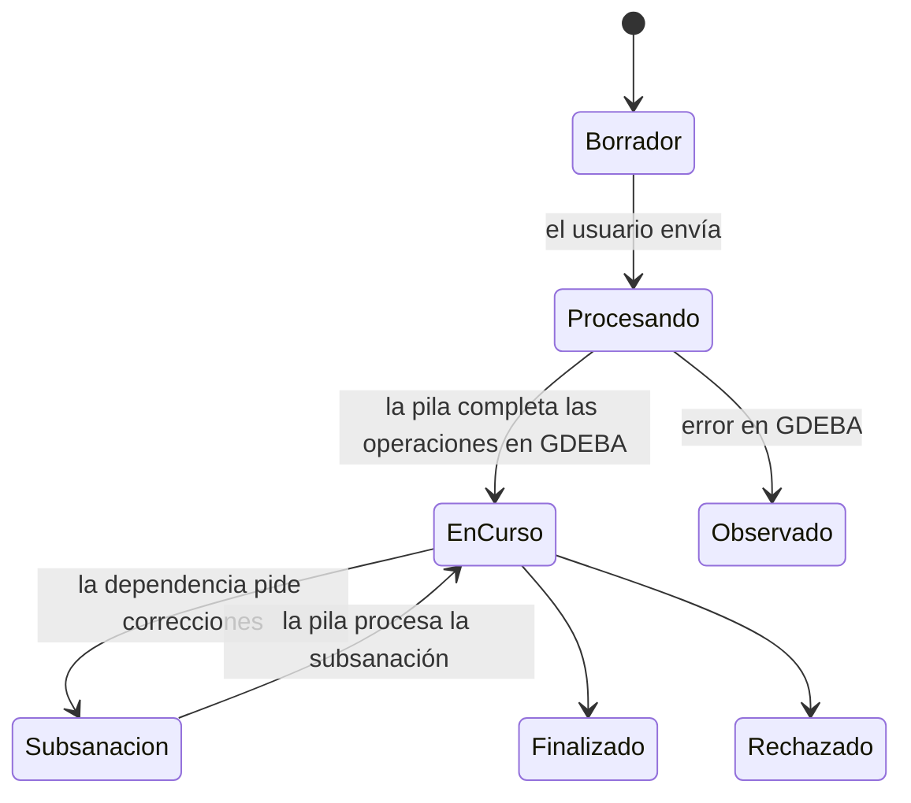
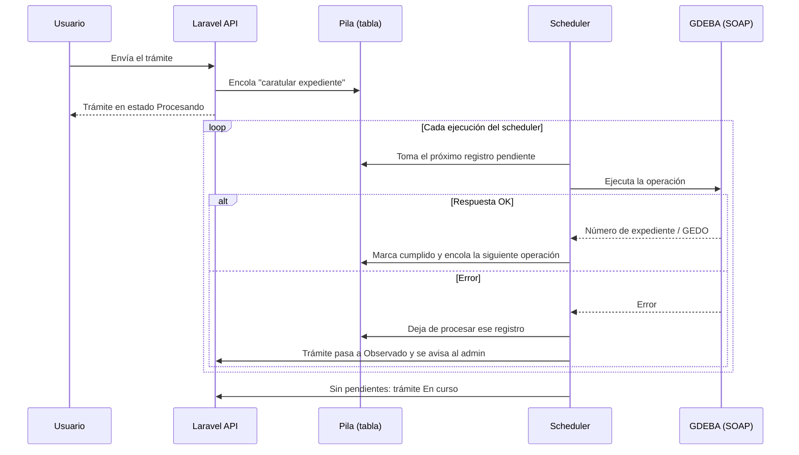

# Trámites a Distancia PBA — caso de estudio

Backend en **Laravel** que permite a empresas y personas de la Provincia de Buenos Aires iniciar trámites del Ministerio de Producción por internet. Cada trámite termina convertido en un **expediente electrónico en GDEBA**, el sistema de gestión documental de la Provincia.

Trabajé en este sistema como desarrollador contratado, dentro de un equipo con analistas funcionales, desarrolladores y testers. Este repositorio documenta cómo funciona y cuál fue mi aporte. **El código pertenece al Ministerio y no se publica**; acá no hay código, datos ni configuración del sistema real.

---

## Mi aporte principal: el administrador de trámites

**El problema.** Publicar un trámite nuevo implicaba cargar a mano filas en varias tablas relacionadas (trámite, formularios, pasos, bloques y tipos de documento) y escribir a mano el JSON Schema con el que el frontend dibuja el formulario. Era lento y cualquier error rompía el trámite.

**La solución.** Construí un panel de administración (Blade + AdminLTE) donde una persona no técnica define el trámite completo: nombre, dependencia, repartición y sector de destino en GDEBA, descripción, instructivo y documentación requerida. Al guardar, el sistema genera todo lo demás:

- Valida los datos de entrada y asigna un código interno y una versión al trámite.
- Crea **dos formularios**, uno para persona física y otro para persona jurídica, porque cada una pide datos y documentos distintos.
- Arma los **pasos** y **bloques** de cada formulario.
- Por cada documento requerido, reutiliza el tipo de documento si ya existe o lo crea en el repositorio de tipos, y lo asigna a persona física, jurídica o ambas.
- Genera el **JSON Schema** del formulario y sus **reglas de lógica** (por ejemplo, la "trata" de GDEBA que corresponde al trámite, o los campos de domicilio que se derivan de un autocompletado).
- Permite activar, desactivar y monitorear el uso de cada trámite. La baja elimina todas las piezas relacionadas dentro de una transacción.

**El resultado.** Las altas de trámites pasaron de **8 a 24 por mes**.

---

## Arquitectura general

- **API REST** protegida con **JWT** para el frontend, y un **guard separado** para el panel de administración. Roles y permisos con `spatie/laravel-permission`.
- **Representantes y apoderados**: una persona puede operar en nombre de una o varias empresas, con permisos por trámite. Las altas y bajas de permisos se notifican por mail mediante Mailables en cola.
- **Repositorio de documentos por CUIT**: el usuario sube imágenes y PDFs, el sistema los unifica en un solo PDF (ImageMagick y Ghostscript) y los guarda para reutilizarlos en otros trámites.
- **Tablas de referencia** (jurisdicciones, actividades, localidades, naturaleza jurídica, etc.) expuestas por API para los formularios.
- **Auditoría** con un trigger de MySQL que copia los datos de la empresa a una tabla de auditoría antes de borrarlos.
- **Logs a medida**: handlers que avisan al administrador cuando falla una operación y notifican novedades al usuario.

---

## Ciclo de vida de un trámite

---

## La pila de operaciones GDEBA

GDEBA es un servicio SOAP externo. Para que un trámite llegue a ser expediente hay que ejecutar varias operaciones **en un orden estricto**, y cada una depende del resultado de la anterior:

1. Caratular el expediente (devuelve el número de expediente).
2. Grabar el formulario controlado con los datos cargados.
3. Generar los documentos oficiales (GEDO) a partir de lo que subió el usuario.
4. Vincular esos documentos al expediente y hacerlos definitivos.
5. Dar el pase del expediente a la repartición y sector de destino.

En lugar de llamar a GDEBA en el mismo request del usuario, cada operación se encola como un registro en una tabla. Una tarea del **Scheduler** procesa la pila trámite por trámite, en orden de llegada:

**Por qué así:** un fallo de GDEBA no le rompe la experiencia al usuario, las operaciones no se duplican, y cada referencia que devuelve GDEBA queda guardada para retomar el proceso desde donde quedó. Un lock evita que dos ejecuciones procesen la pila al mismo tiempo.

---

## Stack

PHP 7.1 · Laravel 5.6 · MySQL · Blade · AdminLTE · jQuery · Bootstrap · SOAP · Guzzle · JWT · spatie/laravel-permission · Colas y Scheduler de Laravel · ImageMagick · Ghostscript · Git

---

## Lo que haría distinto hoy

Con Laravel actual y lo que aprendí después, cambiaría algunas decisiones:

- **Jobs encadenados** (`Bus::chain`) con `ShouldBeUnique` en lugar de una pila propia con lock en archivo. Se gana reintentos con backoff y visibilidad de los fallos.
- **Form Requests** para la validación, y el alta del trámite en una clase de servicio con **todo el proceso dentro de una sola transacción**.
- **Archivos en storage** (disco local o S3) en lugar de guardar los PDFs en base64 en la base.
- **Tests de feature** para el alta de trámites y para la pila, con el cliente SOAP mockeado.
- **Enums nativos de PHP 8.1** para los estados del trámite.

---

## Contacto

**Pedro Díaz** — Desarrollador Full-Stack (PHP, Laravel, MySQL), La Plata.
[josepedrodiaz.com](https://josepedrodiaz.com) · josepedrodiaz@gmail.com

Con gusto recorro cualquier parte de este sistema en detalle en una charla técnica.
